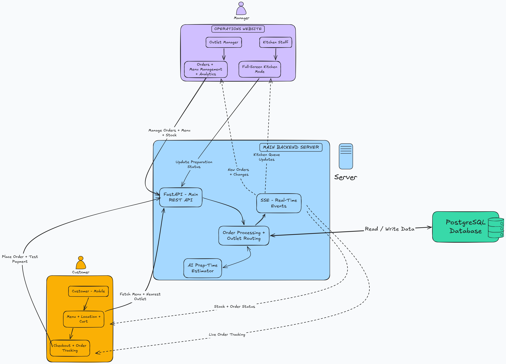

# OrderDesk

Direct food ordering and kitchen operations for a fictional Hyderabad restaurant chain with 14 outlets and three cloud kitchens.

- [Customer website](https://orderdesk-frontend.vercel.app/)
- [Operations website](https://orderdesk-operations.vercel.app/)
- [Technical Design Document](docs/OrderDesk-TDD.pdf)
- [Local setup, deployment and reviewer accounts](deployment.md)

## Run locally

Install Git and Docker with the Compose plugin, then:

```bash
git clone https://github.com/deveshsawant05/orderdesk.git
cd orderdesk
cp .env.example .env
```

In `.env`, set `POSTGRES_PASSWORD` to a locally generated hexadecimal password. Set `DEMO_PASSWORD` to the public reviewer password listed in [deployment.md](deployment.md), and retain the template's demo seeding settings.

```bash
docker compose up -d --build
```

Open the customer app at **http://localhost:3000** and operations at **http://localhost:3001/login**. Compose starts PostgreSQL, runs migrations and seeds sample data. No host-side Node.js, Python or PostgreSQL installation is required. See [deployment.md](deployment.md) for credentials and troubleshooting.

## What works

- Hyderabad map/address selection and automatic outlet selection using delivery radii.
- Menu photos, portions, add-ons, cart, coupons and simulated UPI/card payments.
- Live kitchen tickets and customer tracking through server-sent events, with road-distance arrival estimates.
- Central menu and outlet stock controls, with server-side validation at checkout.
- Outlet dashboards and an all-outlet manager view with scoped permissions.
- Separate party-order history, manager confirmation and scheduled kitchen fulfilment.
- A rotating fullscreen menu display with a QR code linking to the customer site.

## Architecture



`frontend/` and `operations/` are independently deployable Next.js applications. Both proxy browser `/api` requests to the shared FastAPI backend. PostgreSQL stores transactional records and the durable event log. The current demo deploys both frontends on Vercel and the API/database on one AWS EC2 instance.

Preparation uses demo coefficients pre-fitted on synthetic data, with current kitchen inputs, outlet minimums and a deterministic fallback. Delivery time is added separately from road distance. This is not a continuously trained kitchen model or live traffic prediction. The [TDD](docs/OrderDesk-TDD.pdf) explains the choices, data flow, assumptions and limits.

## Project structure

- `frontend/` — customer ordering, checkout, tracking and party requests.
- `operations/` — manager dashboard, order desk, CMS, kitchen and menu display.
- `backend/` — FastAPI, SQLAlchemy models, Alembic migrations and domain tests.
- `compose.yaml` — local services and persistent PostgreSQL volume.
- `docs/` — architecture diagram and technical design.

## Demo boundaries

Use fictitious customer details only. Payments and outbound messages are mocked; licences and outlet pins are sample configuration. Phone verification is skipped in the demo, so knowing a number permits recovery of its history. The current checkout does not expose the backend loyalty redemption flow. Production peak capacity, real-device usability and real-world model accuracy are not claimed.

Keep `.env` private. Before real customer use, add verified phone authentication, HTTPS to the API, validated business data, backups and appropriate production security controls. Public reviewer credentials are for evaluation only.
